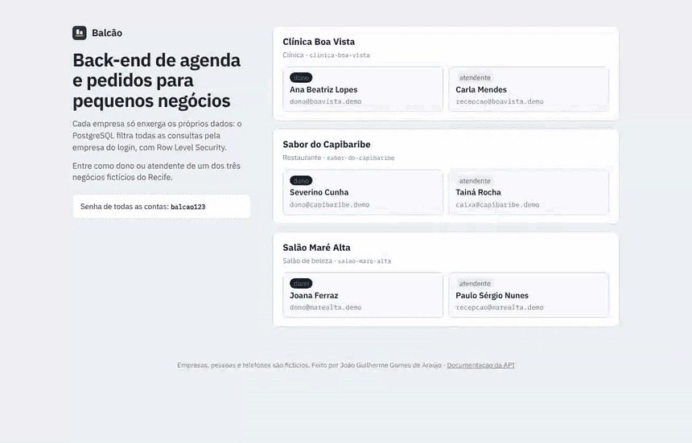
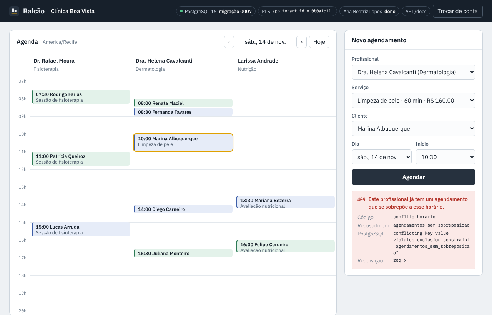
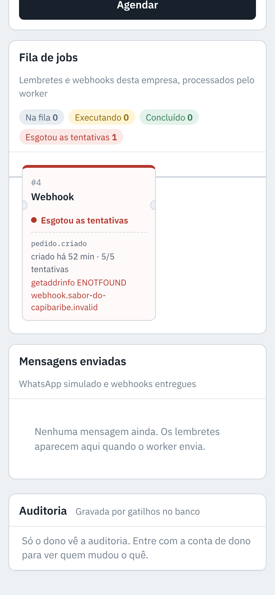
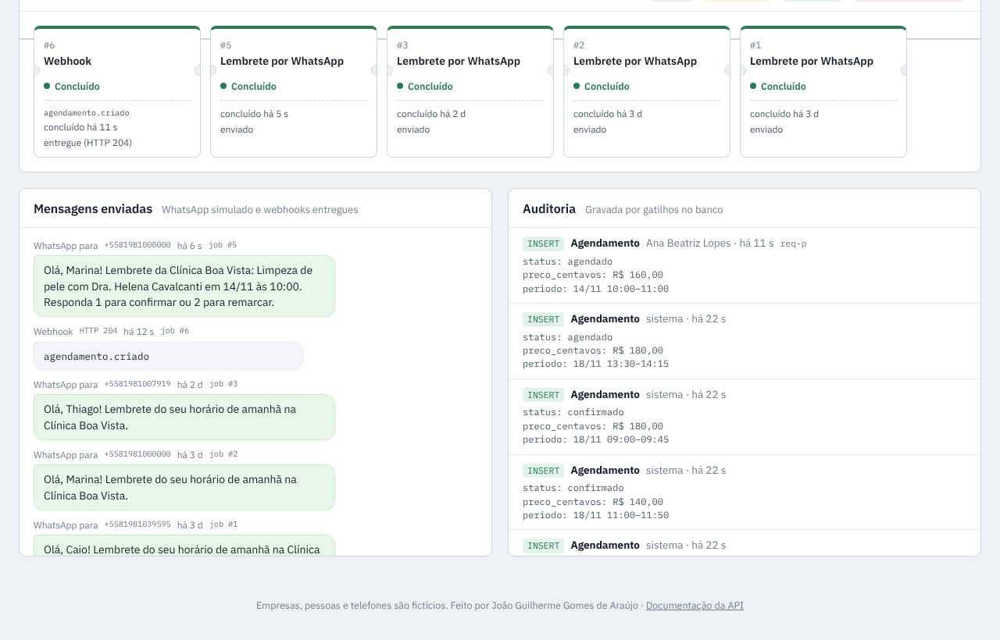
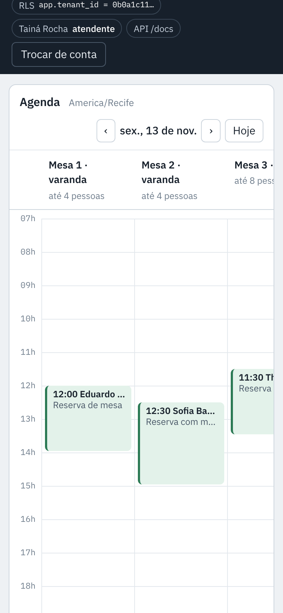
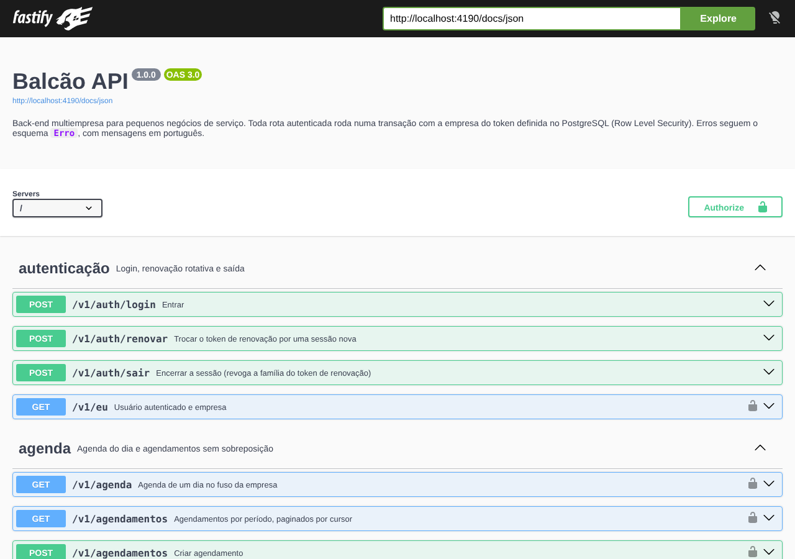

<div align="center">

# Balcão

**Back-end multiempresa para clínicas, salões e restaurantes: agenda que nunca marca dois clientes no mesmo horário, dados de cada empresa isolados pelo próprio PostgreSQL e lembretes que saem mesmo quando algo falha.**

Node 22, TypeScript estrito e Fastify sobre um PostgreSQL 16 dedicado, sem Supabase nem Firebase. Roda no seu computador e em qualquer VM com Docker, com um comando.

[](https://github.com/PRESSXF/balcao-api/actions/workflows/ci.yml)


[**Rodar localmente**](#rodar-localmente) · [Como funciona](#como-funciona) · [Testes](#testes) · [Números](#n%C3%BAmeros) · [Arquitetura](docs/ARQUITETURA.md)



</div>

## O problema

Negócio pequeno de serviço vive de agenda. Quando dois atendentes marcam o mesmo horário ao mesmo tempo, o cliente chega e a profissional já está ocupada. Quando o lembrete do dia seguinte não sai, o cliente falta. Quando um sistema atende várias empresas, um filtro esquecido numa consulta mostra a agenda da clínica para o salão do lado.

Esses erros quase sempre nascem do mesmo lugar: a regra está só no código da aplicação. Basta uma rota nova, um script de correção ou duas requisições simultâneas para ela não valer.

## A solução

O Balcão coloca as garantias que não podem falhar dentro do PostgreSQL, onde valem para qualquer caminho de escrita, e deixa a API fina.

| Garantia | Como é feita | Prova |
|---|---|---|
| Uma empresa nunca vê dados de outra | Row Level Security forçado em todas as tabelas; a API conecta com um papel sem privilégios e define `app.tenant_id` em cada transação | A suíte de RLS tenta escapar com SQL escrito de propósito: filtro pelo id da outra empresa, `OR true`, CTE, `UPDATE` sem filtro, troca de `tenant_id` |
| Esquecer a empresa não vaza nada | Sem `app.tenant_id`, as políticas não deixam passar nenhuma linha e recusam inserções | Teste percorre as 11 tabelas sem empresa definida: zero linhas em todas |
| Dois agendamentos nunca se sobrepõem | Restrição de exclusão `EXCLUDE USING gist (tenant_id =, profissional_id =, periodo &&)` | 10 inserções simultâneas no mesmo horário: entra uma, o banco recusa as outras 9 (a API responde `409`) |
| Total do pedido sempre certo | Gatilho por comando recalcula a soma dos itens, em centavos | Teste confere o total e que 2 itens geram 1 só atualização |
| Toda mudança fica registrada | Gatilhos gravam quem, o quê, antes e depois, com o id da requisição; a API não pode alterar nem apagar | Teste de `INSERT`, `UPDATE` e `DELETE`, e de que o hash de senha nunca entra |
| Lembrete e webhook não se perdem | Fila no próprio banco: o job nasce na mesma transação do agendamento, workers usam `FOR UPDATE SKIP LOCKED`, com tentativas e fila de mortos | 12 consumidores disputando 300 jobs: nenhum sai duas vezes |
| Pedido repetido não duplica | Cabeçalho `Idempotency-Key` com índice único por empresa | 8 requisições simultâneas com a mesma chave criam 1 pedido |

## A interface

O console é servido pela própria API em `/` e existe para mostrar o que o banco garante. A tela de entrada lista as contas de demonstração; depois de entrar, a agenda do dia, o formulário que devolve a resposta crua da API (inclusive a restrição do PostgreSQL que recusou), a fila de jobs como um trilho de tickets que mudam de estado ao vivo, as mensagens enviadas e a auditoria.

<table>
  <tr>
    <td width="68%"></td>
    <td></td>
  </tr>
  <tr>
    <td></td>
    <td></td>
  </tr>
</table>

A documentação da API é gerada a partir dos esquemas das rotas (OpenAPI 3) e fica em `/docs`, com o botão "Try it out" funcionando contra o banco local.



## Como funciona

```
                      ┌──────────────────────────────── docker compose ───────────────────────────────┐
navegador / cliente   │                                                                                │
  │  HTTPS (Caddy)    │   api  (Fastify, papel balcao_app)              worker  (papel balcao_worker)  │
  └──────────────────►│    ├─ JWT de acesso ─► req.db(fn)                 ├─ LISTEN balcao_jobs        │
                      │    │     BEGIN                                     ├─ pega jobs: FOR UPDATE     │
                      │    │     set_config('app.tenant_id', $1, true)     │    SKIP LOCKED             │
                      │    │     ... SQL da rota ...                       ├─ executa com a empresa     │
                      │    │     INSERT jobs (mesma transação)             │    do job (RLS de novo)    │
                      │    │     COMMIT ──────── NOTIFY ─────────────────► ├─ lembrete ─► outbox       │
                      │    ├─ /docs  /metrics  /ready                      └─ webhook ─► POST assinado  │
                      │    └─ console estático em /                              (HMAC-SHA256)         │
                      │                         │                                │                     │
                      │                         ▼                                ▼                     │
                      │   db  PostgreSQL 16 ── RLS forçado em 11 tabelas · restrição de exclusão ·    │
                      │        gatilhos de auditoria e total · fila jobs/outbox · volume nomeado      │
                      └────────────────────────────────────────────────────────────────────────────────┘
```

Uma requisição autenticada percorre sempre o mesmo caminho: o token é conferido, `req.db(fn)` abre uma transação, define a empresa e o usuário com `set_config(..., true)` (equivalente a `SET LOCAL`), roda o SQL da rota e faz COMMIT. A configuração morre com a transação, então a conexão volta limpa para o pool mesmo se a rota falhar.

Erros do banco viram respostas com significado e mensagem em português: a restrição de exclusão vira `409 conflito_horario`, chave estrangeira composta vira `422 referencia_invalida`, exceção de gatilho vira `422` com a mensagem do próprio gatilho. Todo erro tem o mesmo formato:

```json
{
  "erro": {
    "codigo": "conflito_horario",
    "mensagem": "Este profissional já tem um agendamento que se sobrepõe a esse horário.",
    "detalhes": [{ "restricao": "agendamentos_sem_sobreposicao", "mensagem": "conflicting key value violates exclusion constraint ..." }]
  },
  "requisicao": "req-y"
}
```

Detalhes e as 13 decisões numeradas em [`docs/ARQUITETURA.md`](docs/ARQUITETURA.md).

## Testes

120 testes. Os 79 de integração rodam contra um **PostgreSQL 16 de verdade**, recriado do zero a cada execução a partir das migrações. Nada de banco simulado: o que está sendo testado é justamente o comportamento do banco.

| Arquivo | O que prova |
|---|---|
| `integration/rls.test.ts` (17) | papel sem `BYPASSRLS`; todas as tabelas com `tenant_id` têm RLS forçado; consultas forjadas não alcançam outra empresa; sem empresa, nada; `SET LOCAL` não vaza pelo pool; API não desliga RLS nem troca de papel |
| `integration/regras-sql.test.ts` (11) | sobreposição recusada inclusive sob concorrência; horários encostados aceitos; cancelado libera; transições de status; checagens; total por gatilho; auditoria |
| `integration/fila.test.ts` (15) | idempotência e transação do enfileiramento; `executar_em`; 300 jobs com 12 consumidores; backoff e fila de mortos; trava expirada; NOTIFY acorda em menos de 1 s; desligamento espera o job; lembrete e webhook assinado de ponta a ponta |
| `integration/api.test.ts` (29) | login e limite de tentativas; token adulterado e expirado; renovação rotativa com detecção de reuso; papéis; validação em português; cursor; 409 e 422 do banco; idempotência concorrente; `/ready`, `/metrics` e OpenAPI |
| `integration/migracoes.test.ts` (7) | ordem, idempotência, migração quebrada não deixa resto, checksum de migração editada, arquivo ausente |
| `unit/*` (41) | scrypt, JWT, token de renovação, assinatura de webhook, backoff, tradução de erros, cursor, mensagem de lembrete |

```bash
npm run test:db   # sobe um PostgreSQL descartável (Docker ou initdb local) e roda tudo
```

## Números

Uma máquina com 2 vCPU e 8 GB, dividida entre o gerador de carga, a API (um processo) e o PostgreSQL. Base com 53 empresas, 100 mil clientes e 200 mil agendamentos. 20 conexões, 15 s por cenário. Metodologia e leitura em [`docs/CARGA.md`](docs/CARGA.md).

| Cenário | req/s | p50 | p95 | p99 | Erros |
|---|---|---|---|---|---|
| `GET /health` (sem banco) | 18.264 | 1,0 ms | 2,2 ms | 4,8 ms | 0 |
| `GET /v1/agenda` (RLS, 4 tabelas, 50 linhas) | 489 | 39,5 ms | 57,5 ms | 68,1 ms | 0 |
| `GET /v1/clientes` (página com cursor) | 1.706 | 11,0 ms | 17,2 ms | 22,7 ms | 0 |
| `POST /v1/pedidos` (escrita, gatilhos, fila) | 592 | 33,0 ms | 47,1 ms | 54,2 ms | 0 |

Cada índice tem o `EXPLAIN ANALYZE` com e sem ele em [`docs/EXPLAIN.md`](docs/EXPLAIN.md). O destaque é o worker: com 300 mil jobs concluídos na tabela, pegar o próximo leva **0,03 ms** com o índice parcial `jobs_prontos` e 67 ms sem ele. O mesmo documento registra um achado que virou a migração `0008`: sob RLS, o PostgreSQL ignorava o índice em `lower(periodo)` porque a função não é `LEAKPROOF`.

## Rodar localmente

Requer Docker com o plugin Compose.

```bash
git clone https://github.com/PRESSXF/balcao-api.git
cd balcao-api
docker compose up
```

Na primeira vez o Compose constrói a imagem, sobe o PostgreSQL, aplica as migrações, define as senhas dos papéis e insere os dados de demonstração. Depois:

| Endereço | O que é |
|---|---|
| http://localhost:4280 | Console: escolha uma das contas (senha `balcao123`) |
| http://localhost:4280/docs | Documentação OpenAPI com "Try it out" |
| http://localhost:4280/metrics | Métricas no formato do Prometheus |
| http://localhost:4280/ready | Prontidão: banco acessível e migração esperada |
| `localhost:55432` | PostgreSQL (usuário `balcao`, senha `balcao_dev`), só na interface local |

Para ver a recusa do banco, crie um agendamento e clique em **Agendar** de novo num horário que cruze o primeiro. Para ver a fila de mortos, entre no Sabor do Capibaribe: o webhook do restaurante aponta para um endereço que não existe.

Sem Docker, com um PostgreSQL 16 qualquer e Node 22:

```bash
cp .env.example .env            # ajuste as URLs e o JWT_SECRET
npm install
npm run db:preparar             # migrações, papéis e dados de demonstração
npm run build
npm start                       # API e console na porta 4280
npm run start:worker            # em outro terminal
```

| Comando | O que faz |
|---|---|
| `npm run dev` / `npm run dev:worker` | API e worker com recarga automática |
| `npm run db:migrar` / `npm run db:status` | Aplica migrações / mostra aplicada, pendente, alterada ou ausente |
| `npm run db:semear` / `npm run db:carga` | Dados de demonstração / 50 empresas e 200 mil agendamentos para medir |
| `npm test` | Testes unitários |
| `npm run test:integration` | Testes contra o banco em `TEST_DATABASE_URL` |
| `npm run test:db` | Sobe um PostgreSQL descartável e roda todos os testes |
| `npm run lint` / `npm run typecheck` / `npm run build` | ESLint / tipos / build da API e do console |
| `npm run explain` / `npm run carga` | Gera `docs/EXPLAIN.md` / roda o teste de carga e gera `docs/CARGA.md` |
| `npm run backup` / `npm run restore:verificar` | `pg_dump` em formato custom / restaura num banco temporário e confere |

## Operação

- **Implantar em qualquer VM Linux** (Docker, Caddy com HTTPS automático, firewall, backups no cron): [`docs/DEPLOY.md`](docs/DEPLOY.md).
- **Backup:** `scripts/backup.sh` gera `pg_dump -Fc` com SHA-256 e apaga os antigos; `scripts/restore-verify.sh` restaura num banco temporário e confere migração, RLS forçado, restrição de exclusão, gatilhos, dono da função da fila e isolamento com o papel da API.
- **Encerramento gracioso:** no `SIGTERM`, a API termina as requisições em andamento e o worker termina os jobs antes de sair. Job de worker que morreu no meio volta para a fila pelo tempo limite da trava.
- **Logs** estruturados em JSON (pino) com o id da requisição, que também aparece na resposta de erro e na auditoria.

## Estrutura

```
db/migrations/        8 migrações SQL versionadas (extensões e papéis, cadastros, agenda e pedidos,
                      auditoria, fila, RLS, índices, coluna indexável sob RLS)
src/
├── db/               pool e withTenant(), executor de migrações, papéis, dados de demonstração
├── auth/             scrypt, JWT HS256, tokens de renovação rotativos
├── http/             app Fastify, erros em português, métricas, rotas (auth, agenda, cadastros,
│                     pedidos, painel, operação, demo)
├── jobs/             fila (pegar, concluir, falhar, recuperar), worker, handlers, assinatura HMAC
├── cli/db.ts         migrar, status, papeis, semear, preparar
├── server.ts         processo da API
└── worker-main.ts    processo do worker, com /health e /metrics próprios
console/              console web (TypeScript sem framework, Vite)
scripts/              test-db, backup, restore-verify, explain, carga
tests/unit/           sem banco
tests/integration/    contra PostgreSQL 16 real
docs/                 ARQUITETURA, DEPLOY, EXPLAIN, CARGA, media/
```

## Stack

Node 22, TypeScript em modo estrito, Fastify 5 com TypeBox (validação e OpenAPI a partir do mesmo esquema), `pg` com SQL escrito à mão, PostgreSQL 16 (`btree_gist`, `citext`), pino, prom-client, Vitest, autocannon, Docker Compose e GitHub Actions com PostgreSQL como serviço. Autenticação com `node:crypto`, sem biblioteca de JWT.

## Próximos passos

- Envio real de WhatsApp pela API oficial, trocando só o handler do lembrete.
- Horários livres calculados com a [agenda-slots](https://github.com/PRESSXF/agenda-slots) antes de oferecer ao cliente; o banco continua sendo a última palavra.
- Limpeza periódica de jobs concluídos e particionamento da auditoria por mês.
- Cadastro de empresas e usuários pela API (hoje só pelo seed ou SQL).
- Chave de assinatura dos webhooks cifrada no banco e rotação sem indisponibilidade.

## Licença

Todos os direitos reservados. O código está público para avaliação: você pode lê-lo e rodá-lo localmente para conhecer o projeto. Copiar, modificar ou usar em outro projeto exige autorização por escrito. Detalhes em [`LICENSE`](LICENSE).

---

Clínica Boa Vista, Salão Maré Alta e Sabor do Capibaribe são negócios fictícios. Pessoas, telefones e agendamentos foram inventados para a demonstração.

Feito por [João Guilherme Gomes de Araújo](https://www.linkedin.com/in/joaoguilhermegr/) · [ClairiX](https://clairix.enterprises/cases)
